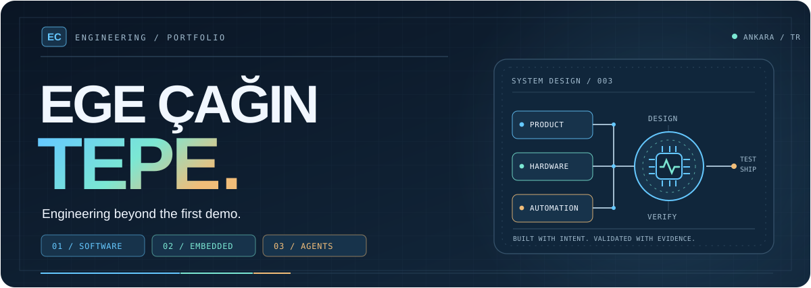
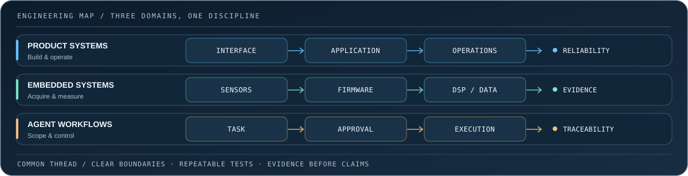
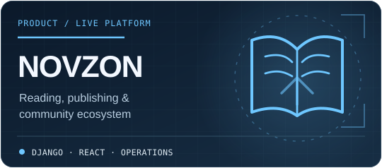
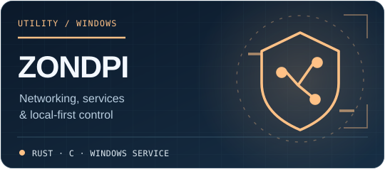
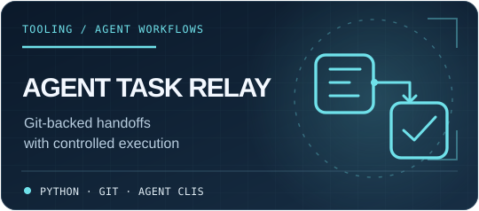
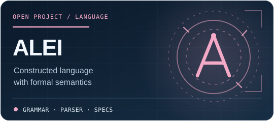

<picture>
  <source media="(prefers-color-scheme: light)" srcset="./assets/hero-light.svg" />
  
</picture>

 

**Electrical & Electronics Engineering** · **Software & Product Engineering** · **Embedded Systems**

[**NovZon / Live product**](https://novzon.net) &nbsp; · &nbsp; [**LinkedIn**](https://www.linkedin.com/in/egecagintepe/) &nbsp; · &nbsp; [**Contact**](mailto:napryzon@gmail.com)

ANKARA, TÜRKİYE &nbsp; / &nbsp; BUILDING SOFTWARE THAT CONNECTS TO THE REAL WORLD

---

## 01 / About

I'm Ege, a final-year Electrical & Electronics Engineering student who builds across **software, hardware and developer infrastructure**.

My work includes a live publishing platform, embedded diagnostics, heart-sound acquisition software, Windows system tooling and experiments in reliable AI-assisted development. I enjoy building useful things — but I'm especially interested in the engineering that makes them **testable, operable and safe to change**.

> A successful demo is a starting point. What matters next is how the system handles real inputs, failures, maintenance and verification.

## 02 / Engineering map

<picture>
  <source media="(prefers-color-scheme: light)" srcset="./assets/engineering-map-light.svg" />
  
</picture>

Three connected areas of work, not a diagram of a single deployed architecture.

## 03 / Selected work

The projects below represent different stages of engineering, from deployed products to open tools and research prototypes. Their status is identified deliberately — **a software test is not the same as physical or production validation**.

<table>
  <tr>
    <td width="50%" valign="top">
      
      
<b>NovZon</b> · Live platform

      
Reading, original publishing and community products connected by a shared software platform. I work on product development, backend workflows and operational reliability.

      
<a href="https://novzon.net">Visit the product</a> · <a href="https://github.com/egecagintepe/novzon-platform">Public showcase</a>

    </td>
    <td width="50%" valign="top">
      
      
<b>AuscultaForge</b> · Senior-design prototype

      
ESP32-S3 heart-sound acquisition, USB streaming, a Windows host, real-time DSP and recording-quality assessment. Software verification is distinct from ongoing physical measurements.

      
<a href="https://github.com/egecagintepe/ausculta-forge">View engineering project</a>

    </td>
  </tr>
  <tr>
    <td width="50%" valign="top">
      
      
<b>BoardMedic</b> · Open-source utility

      
Cross-platform embedded board diagnostics with evidence-based recovery planning, offline fixtures and safety checks around destructive actions.

      
<a href="https://github.com/egecagintepe/BoardMedic">Source &amp; documentation</a>

    </td>
    <td width="50%" valign="top">
      
      
<b>ZonDPI</b> · Open-source Windows utility

      
Local networking tooling built around Rust/C components, a Windows background service, IPC and a desktop interface.

      
<a href="https://github.com/egecagintepe/ZonDPI">Source &amp; releases</a>

    </td>
  </tr>
  <tr>
    <td width="50%" valign="top">
      
      
<b>Agent Task Relay</b> · Source-available developer tool

      
Git-backed task handoff between conversational AI and local coding agents, designed for traceable changes and bounded execution.

      
<a href="https://github.com/egecagintepe/agent-task-relay">Explore the workflow</a>

    </td>
    <td width="50%" valign="top">
      
      
<b>Alei</b> · Open language-design project

      
A human-first constructed language combining expressive writing with documented grammar, structured semantics and parser-based checks.

      
<a href="https://github.com/egecagintepe/alei-language">Read the language specification</a>

    </td>
  </tr>
</table>

## 04 / The way I work

| Principle | What it means in practice |
| :--- | :--- |
| **Build for operations** | Consider jobs, dependencies, recovery paths, logging and deployment from the start — not only the happy path. |
| **Verify claims** | Keep tests, simulations, hardware measurements and production observations separate, with their limitations stated. |
| **Make automation accountable** | Prefer explicit scope, reviewable outputs, permissions and human approval for potentially destructive actions. |

<b>More on engineering scope and validation</b>

**NovZon** — I build and operate parts of a production software platform. The [public repository](https://github.com/egecagintepe/novzon-platform) is a product overview, not a distribution of its private production code.

**AuscultaForge** — My primary focus includes the host application, firmware and integration work, streaming signal processing, recording, and repeatable software-level verification. The project is an undergraduate engineering prototype, **not a certified medical or diagnostic device**.

**AI-assisted engineering** — I use coding agents to help design and implement systems while treating independent validation, safety boundaries and human oversight as separate responsibilities.

## 05 / Developer tools

Smaller open repositories inspired by recurring engineering and production problems:

| Project | Focus |
| :--- | :--- |
| **[Agent Project Onboarding](https://github.com/egecagintepe/agent-project-onboarding)** | Evidence-based repository context, scope boundaries and incident memory for AI coding agents. |
| **[Production Deploy Guardian](https://github.com/egecagintepe/production-deploy-guardian)** | Conservative deployment classification, destructive-operation safeguards and bounded triage. |
| **[Celery Reliability Engineer](https://github.com/egecagintepe/celery-reliability-engineer)** | Background-task configuration checks, fail-closed coordination and resilient retry strategies. |

## 06 / Technologies in context

I prefer to show technologies through working repositories rather than collect badges.

| Domain | Languages, tools &amp; systems |
| :--- | :--- |
| **Backend &amp; data** | Python, Django, FastAPI, PostgreSQL, Celery, Redis, APIs |
| **Frontend &amp; clients** | TypeScript, React, modern web interfaces, desktop workflows |
| **Systems &amp; delivery** | Linux, Docker, GitHub Actions, CI, Git, observability |
| **Embedded &amp; signals** | C / C++, ESP32, serial / USB transport, DSP, instrumentation |
| **Tools &amp; agents** | Rust, Python CLIs, structured task protocols, validation and guardrails |

## 07 / On the bench

**BUILDING** — [NovZon](https://novzon.net): product features, platform infrastructure and production reliability.

**VALIDATING** — [AuscultaForge](https://github.com/egecagintepe/ausculta-forge): embedded acquisition and repeatable PCG measurement workflows.

**EXPLORING** — [Agent tooling](https://github.com/egecagintepe/agent-task-relay) and [Alei](https://github.com/egecagintepe/alei-language): controlled human–agent collaboration and human-centered language design.

---

DESIGN &nbsp; / &nbsp; BUILD &nbsp; / &nbsp; TEST &nbsp; / &nbsp; VERIFY &nbsp; / &nbsp; ITERATE

  

**[Website](https://novzon.net) · [LinkedIn](https://www.linkedin.com/in/egecagintepe/) · [Contact](mailto:napryzon@gmail.com)**

[All repositories](https://github.com/egecagintepe?tab=repositories) · [Contribution history](https://github.com/egecagintepe)

