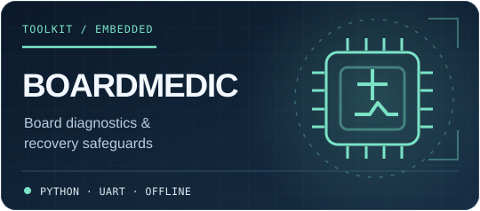
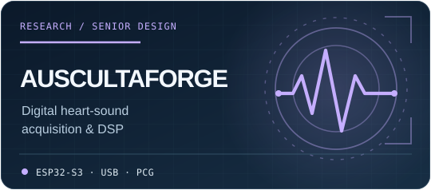

<picture>
  <source media="(prefers-color-scheme: light)" srcset="./assets/hero-light.svg"/>
  
</picture>

 

**Electrical & Electronics Engineering** &nbsp; ✦ &nbsp; **Software Systems** &nbsp; ✦ &nbsp; **Embedded & AI Tooling**

[**Explore NovZon ↗**](https://novzon.net) &nbsp; · &nbsp; [**LinkedIn ↗**](https://www.linkedin.com/in/egecagintepe/) &nbsp; · &nbsp; [**Email ↗**](mailto:napryzon@gmail.com)

BUILDING ACROSS SOFTWARE × HARDWARE × PRODUCT &nbsp; | &nbsp; Ankara, Türkiye

---

### 01 / WHAT I BUILD

I work at the intersection of **production software, embedded systems, and developer tooling**. My projects range from a live digital publishing platform to board diagnostics, signal acquisition, Windows networking, and tools for AI-assisted engineering.

I care about what happens *after* the first successful demo: **reliability, testability, observability, and the difference between a prototype and a verified system.**

### 02 / SELECTED PROJECTS

<table>
  <tr>
    <td width="50%" valign="top">
      
       <b>Live platform</b> · Product engineering, content workflows, asynchronous services. The production code is private; the public repository presents the product and architecture.
    </td>
    <td width="50%" valign="top">
      
       <b>Open source</b> · Offline-capable board diagnostics, evidence-based recovery plans, and safeguards around destructive operations.
    </td>
  </tr>
  <tr>
    <td width="50%" valign="top">
      
       <b>Open source</b> · Windows networking utility with Rust/C components, a background service, local IPC, and operator tooling.
    </td>
    <td width="50%" valign="top">
      
       <b>Senior design</b> · ESP32-S3 acquisition, USB data transport, DSP, session recording, and signal-quality assessment. Physical validation is ongoing; not a clinical device.
    </td>
  </tr>
  <tr>
    <td width="50%" valign="top">
      
       <b>Source-available</b> · Git-based handoff between conversational AI and local coding agents, with task records and controlled execution boundaries.
    </td>
    <td width="50%" valign="top">
      
       <b>Open project</b> · Human-first constructed language with a documented grammar, structured semantics, and parser-based verification.
    </td>
  </tr>
</table>

### 03 / THE ENGINEERING BEHIND THE PROJECTS

| Area | Technologies & practice |
| :--- | :--- |
| **Product & backend** | Python, Django, FastAPI, PostgreSQL, REST APIs, background jobs, Celery / Redis |
| **Interfaces** | React, TypeScript, responsive product interfaces, desktop and web workflows |
| **Systems & delivery** | Linux, Docker, GitHub Actions, CI, logging, incident analysis, deployment safety |
| **Embedded & signal processing** | C / C++, ESP32, USB / serial protocols, instrumentation, streaming DSP, reproducible measurement |
| **Developer & AI tooling** | Rust, Python CLIs, agent workflows, structured task handoffs, explicit approval and safety gates |

<b>▸ A little more about how I work</b>

- **Production systems:** I work on the architecture and operations of [NovZon](https://novzon.net), including reader experiences, backend workflows, background processing, and reliability improvements. Its [public showcase](https://github.com/egecagintepe/novzon-platform) documents the product without exposing private implementation details.
- **Embedded engineering:** In [AuscultaForge](https://github.com/egecagintepe/ausculta-forge), I contribute to firmware, the Windows host stack, the React interface, signal-processing software, and integration testing. Automated tests and real-world acoustic measurements are reported separately.
- **Dependable automation:** In my developer tools, I favor scoped permissions, deterministic checks, auditable changes, and human review for operations that could affect production systems.
- **AI-assisted development:** I use coding agents as engineering tools, not substitutes for testing or evidence. A passing test, a simulated result, and measured hardware behavior are not interchangeable.

### 04 / OPEN DEVELOPER TOOLS

Beyond the featured projects, I maintain smaller tools shaped by real development and operations problems:

- **[Agent Project Onboarding](https://github.com/egecagintepe/agent-project-onboarding)** — repository context and onboarding contracts for coding agents, with scoped documentation and incident memory.
- **[Production Deploy Guardian](https://github.com/egecagintepe/production-deploy-guardian)** — changeset classification and fail-closed deployment checks for AI-assisted workflows.
- **[Celery Reliability Engineer](https://github.com/egecagintepe/celery-reliability-engineer)** — configuration auditing, distributed locking, and retry patterns for background processing.

### 05 / CURRENT FOCUS

`BUILDING` &nbsp; **NovZon** — product experience, backend systems, and production reliability

`VALIDATING` &nbsp; **AuscultaForge** — embedded acquisition and repeatable signal-quality measurements

`EXPLORING` &nbsp; **Agent infrastructure & Alei** — more reliable human–agent collaboration and formal language design

---

DESIGN → BUILD → TEST → VERIFY → ITERATE

  

**[novzon.net](https://novzon.net) · [LinkedIn](https://www.linkedin.com/in/egecagintepe/) · [Get in touch](mailto:napryzon@gmail.com)**

[Explore repositories](https://github.com/egecagintepe?tab=repositories) · [GitHub activity](https://github.com/egecagintepe)

