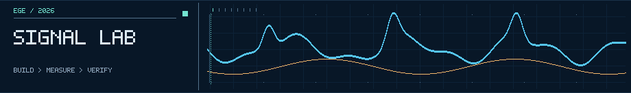
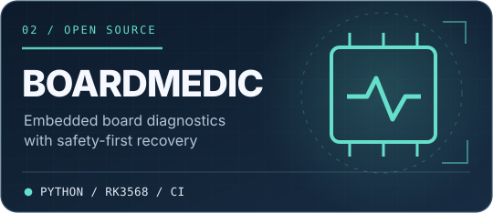
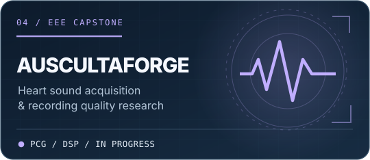

<picture>
  <source media="(prefers-color-scheme: light)" srcset="./assets/hero-light.svg"/>
  
</picture>

 

**Electrical & Electronics Engineering** &nbsp; ✦ &nbsp; **Software Systems** &nbsp; ✦ &nbsp; **Product Engineering**

[**Live platform ↗**](https://novzon.net) &nbsp; · &nbsp; [**LinkedIn ↗**](https://www.linkedin.com/in/egecagintepe/) &nbsp; · &nbsp; [**Email ↗**](mailto:napryzon@gmail.com)

<picture>
  <source media="(prefers-reduced-motion: reduce)" srcset="./assets/signal-footer.svg"/>
  
</picture>

SOFTWARE × HARDWARE × REAL-WORLD SYSTEMS &nbsp; | &nbsp; Ankara, Türkiye

---

### 01 / SELECTED BUILDS

I build where disciplines overlap — a live publishing platform, cross-platform embedded diagnostics, a Windows networking utility, an experimental medical-acoustics workflow, and AI-powered prototypes.

I care about the step after *it works*: **how it behaves under failure, how it is operated and how its behavior is verified.**

<table>
<tr><td width="50%" valign="top"> Production platform · private source, public architecture</td><td width="50%" valign="top"> Open-source · hardware diagnostics and recovery safeguards</td></tr>
<tr><td width="50%" valign="top"> Open-source · Windows network and service tooling</td><td width="50%" valign="top"> EEE capstone · software built, physical validation underway</td></tr>
<tr><td width="50%" valign="top"> Hackathon prototype · offline-first emergency coordination</td><td width="50%" valign="top"> Team project · prompt analysis, guidance and AI interaction</td></tr>
</table>

### 02 / ENGINEERING UNDER THE HOOD

Not a badge collection. These are the languages, tools and systems I use across the work above.

| Layer | Engineering work |
| :--- | :--- |
| **Product & interfaces** | Reader experiences, accessibility/readability, stateful UI, Django SSR / HTMX, React / TypeScript, Astro and Svelte-based surfaces |
| **Backend & data** | Django applications and APIs, FastAPI prototypes, PostgreSQL, SQLAlchemy / SQLite, authentication and data integrity |
| **Async & AI** | Celery / Redis jobs, external API integration, LLM-assisted workflows, structured output checks and quota-aware orchestration |
| **Systems & delivery** | Linux, Docker, GitHub Actions, automated quality gates, observability and production troubleshooting |
| **Electrical & embedded** | Embedded Linux, UART/serial diagnostics, device recovery safety, data acquisition and DSP/PCG signal-quality work in an ongoing capstone |

<b>▸ A closer look: system architecture, testing and responsibilities</b>

**NovZon** — I coordinate product direction and the software platform. The public [architecture showroom](https://github.com/egecagintepe/novzon-platform) explains the major systems; proprietary production code remains private. Its frontend, service and asynchronous processing layers have different responsibilities.

**BoardMedic** — Python-based cross-platform command-line tooling, typed diagnostics, reproducible offline fixtures, and explicit guards for destructive operations. [Source and CI](https://github.com/egecagintepe/BoardMedic).

**ZonDPI** — Rust/C/Windows service components, local IPC, diagnostic CLI and desktop UI. [Source and releases](https://github.com/egecagintepe/ZonDPI).

**AuscultaForge** — In our senior-design team, my primary responsibility is the host application and recording-quality workflow: signal display, DSP, session persistence and repeatable software tests. Physical acoustic characterisation is **in progress**, not a completed clinical device. [Engineering scope](https://github.com/egecagintepe/ausculta-forge).

**TRIAGE & PromptlyAI** — Team/hackathon prototypes exploring offline coordination and LLM-guided interactions respectively. I distinguish prototype demonstrations from field-validated products.

**AI-assisted development** — I use AI tools for implementation, design exploration and review. Generated code, passing tests and independently measured real-world performance are different levels of evidence.

#### Architecture study / NovZon

<picture>
  
</picture>

Conceptual service map, not a complete production or security topology. See the [public architecture repository](https://github.com/egecagintepe/novzon-platform) for subsystem details.

### 03 / GITHUB ACTIVITY

<!-- Dynamic stat panels use third-party renderers; custom illustrations and GIF are self-hosted. -->

<table><tr>
<td width="50%" align="center" valign="middle">
<picture>
  <source media="(prefers-color-scheme: light)" srcset="https://github-readme-stats.vercel.app/api?username=egecagintepe&amp;show_icons=true&amp;hide_border=true&amp;bg_color=F0F4F7&amp;title_color=116AB3&amp;text_color=263B4E&amp;icon_color=158F82&amp;rank_icon=github"/>
  
</picture>
</td>
<td width="50%" align="center" valign="middle">
<picture>
  <source media="(prefers-color-scheme: light)" srcset="https://github-readme-stats.vercel.app/api/top-langs/?username=egecagintepe&amp;layout=compact&amp;langs_count=8&amp;hide_border=true&amp;bg_color=F0F4F7&amp;title_color=116AB3&amp;text_color=263B4E"/>
  
</picture>
</td>
</tr></table>

<picture>
  <source media="(prefers-color-scheme: light)" srcset="https://streak-stats.demolab.com/?user=egecagintepe&amp;background=F0F4F7&amp;ring=116AB3&amp;fire=B56325&amp;currStreakLabel=158F82&amp;sideLabels=596E81&amp;dates=596E81&amp;stroke=D8E3EC&amp;border=D8E3EC&amp;hide_border=true"/>
  
</picture>

Live stats are rendered by third-party services and can be temporarily unavailable or rate-limited; public-repository statistics do not represent every private contribution. [See the native GitHub contributions chart ↗](https://github.com/egecagintepe)

### 04 / ON MY BENCH RIGHT NOW

`BUILDING` &nbsp; **NovZon** — reader experience, platform workflows, reliability and operating tools

`VALIDATING` &nbsp; **AuscultaForge** — PCG recording, acquisition interfaces and measurement workflows

`EXPLORING` &nbsp; **Embedded/software systems** — diagnostics, testability and failure recovery

<picture>
  
</picture>

Design · build · verify · iterate

**[novzon.net](https://novzon.net) · [LinkedIn](https://www.linkedin.com/in/egecagintepe/) · [Say hello ↗](mailto:napryzon@gmail.com)**

