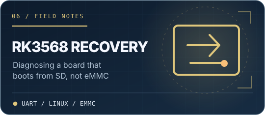

<picture>
  <source media="(prefers-color-scheme: light)" srcset="./assets/hero-light.svg"/>
  
</picture>

 

**Electrical & Electronics Engineering** &nbsp; ✦ &nbsp; **Software & Product Systems** &nbsp; ✦ &nbsp; **Embedded Engineering**

[**Live platform ↗**](https://novzon.net) &nbsp; · &nbsp; [**LinkedIn ↗**](https://www.linkedin.com/in/egecagintepe/) &nbsp; · &nbsp; [**Email ↗**](mailto:napryzon@gmail.com)

---

### 01 / THE WORK

I like building where disciplines overlap: a production media platform, a recovery tool for embedded boards, a networking utility, and an engineering capstone. Different products, same questions: **Does it work? Can we explain it? What happens when it fails?**

<table>
<tr>
  <td width="50%" valign="top"> Private production code · public architecture and case studies.</td>
  <td width="50%" valign="top"> Cross-platform tooling, reproducible offline fixtures and safe recovery planning.</td>
</tr>
<tr>
  <td width="50%" valign="top"> Packet filtering, a Windows service, CLI and desktop interface.</td>
  <td width="50%" valign="top"> Responsible for the host software; physical verification is still in progress.</td>
</tr>
<tr>
  <td width="50%" valign="top"> Hackathon prototype, not a field-validated emergency response system.</td>
  <td width="50%" valign="top"> Evidence-driven recovery investigation with guarded destructive operations.</td>
</tr>
</table>

### 02 / THE TOOLBOX

<strong>↳ More about the systems behind the projects</strong>

| Area | Tools and interests |
| :--- | :--- |
| Application | Python, TypeScript / JavaScript, Rust, C / C++, Django, FastAPI, React |
| Delivery | Docker, Linux, PostgreSQL, Redis, Celery, GitHub Actions, automated tests |
| Hardware & data | Embedded Linux, UART / serial debugging, data acquisition, signal processing |
| Workflow | AI-assisted implementation, review checkpoints, reproducible diagnostics |

I use AI tools extensively to accelerate implementation and exploration. **A generated implementation is not the same as independently verified engineering evidence.** Tests, review and real-world measurements matter.

### 03 / CURRENT FREQUENCY

`BUILDING` &nbsp; **NovZon** — readers, production workflows, platform reliability

`INVESTIGATING` &nbsp; **Embedded systems** — boot failures, evidence, recovery safeguards

`MEASURING` &nbsp; **AuscultaForge** — signal quality, recording pipelines, physical validation

<picture>
  
</picture>

Ankara, Türkiye · Made with curiosity, tested with skepticism · <a href="mailto:napryzon@gmail.com">Say hello ↗</a>

